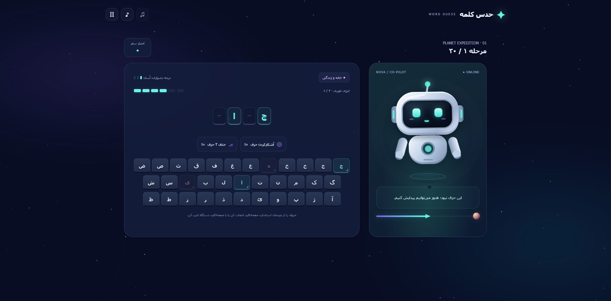

# 🚀 حدس کلمه · Word Guess

<div align="center">


</div>

<div align="right">
بازی مرورگری «حدس کلمه» یک ماجراجویی تک‌نفرهٔ کشف واژه در فضایی میان‌ستاره‌ای است. همراه با ربات کوچک «نوا» حروف را پیدا کنید، واژه‌های پنهان را آشکار کنید و مسیر سفر را روشن نگه دارید. بازی از فارسی و انگلیسی، سفر مرحله‌ای و چالش زمان‌دار پشتیبانی می‌کند و همه‌چیز در یک فایل HTML جای گرفته است.
</div>

## 🎮 بازی کردن

فایل `index.html` را در مرورگری که JavaScript در آن فعال است باز کنید — کافی است فایل را با دوبار کلیک یا کشیدن آن روی پنجرهٔ مرورگر اجرا کنید. نیازی به نصب، سرور محلی یا تنظیمات اضافی نیست.

### 🖼️ پیش‌نمایش بازی

<!-- پس از تهیهٔ تصویر، آن را در مسیر زیر قرار دهید و تگ تصویر را از حالت توضیح خارج کنید.
<p align="center">
  
</p>
-->

پیش‌نمایش بازی را می‌توانید با اجرای فایل `index.html` ببینید.

## 🕹️ نحوهٔ بازی

1. زبان بازی را از میان **فارسی** و **انگلیسی** انتخاب کنید.
2. یکی از دو حالت را انتخاب کنید:
   - **سفر مرحله‌ای:** در نقشه‌ای با ۵ سیاره و ۳۰ مرحله پیش بروید؛ این حالت محدودیت زمانی ندارد.
   - **چالش زمان‌دار:** در ۱۲۰ ثانیه، تا جای ممکن واژه کشف کنید و امتیاز بگیرید.
3. دسته‌بندی واژه، درجهٔ دشواری و جایگاه حروف را بررسی کنید.
4. حروف را با صفحه‌کلید روی صفحه یا صفحه‌کلید دستگاه انتخاب کنید تا واژه کامل شود.
5. در صورت نیاز، از ابزارهای کمکی استفاده کنید و مراقب انرژی ناوبری باشید.

### 📏 قوانین

- حدس‌زدن با انتخاب **حروف** انجام می‌شود؛ ورودی جداگانه‌ای برای حدس کل واژه وجود ندارد.
- هر حرف درست در تمام جایگاه‌هایش آشکار می‌شود.
- انتخاب حرف نادرست یک واحد از انرژی ناوبری کم می‌کند؛ برای هر واژه **۶ فرصت اشتباه** دارید.
- با آشکارشدن همهٔ حروف، واژه حل می‌شود و امتیاز می‌گیرید.
- با ششمین اشتباه، واژه از دست می‌رود و پاسخ نمایش داده می‌شود.
- در سفر مرحله‌ای، حل هر مرحله مسیر مرحلهٔ بعد را باز می‌کند و می‌توانید برای نتیجهٔ بهتر مراحل بازشده را دوباره بازی کنید.
- در چالش زمان‌دار، از دست‌دادن واژه یا انتخاب «واژهٔ بعد» **۵ ثانیه** از زمان باقی‌مانده کم می‌کند؛ سپس واژهٔ تازه‌ای نمایش داده می‌شود.

### 🧰 ابزارهای کمکی

هر ابزار برای **هر واژه فقط یک‌بار** قابل استفاده است:

| ابزار | کاربرد |
| --- | --- |
| آشکارکردن حرف | یک حرف پنهان را انتخاب و تمام جایگاه‌های آن را آشکار می‌کند. |
| حذف ۳ حرف | حداکثر سه حرف نادرست را از صفحه‌کلید حذف می‌کند؛ اگر گزینه‌های کمتری باقی مانده باشد، همان تعداد حذف می‌شود. |

### ⭐ امتیاز و ستاره‌ها

امتیاز هر واژهٔ حل‌شده از سه بخش تشکیل می‌شود:

- **امتیاز پایهٔ دشواری:** آسان ۱۰۰، متوسط ۱۵۰ و سخت ۲۰۰ امتیاز.
- **انرژی باقی‌مانده:** ۱۰ امتیاز به‌ازای هر فرصت اشتباه باقی‌مانده.
- **پاداش بدون ابزار:** ۳۰ امتیاز اضافه، اگر هیچ ابزار کمکی استفاده نشده باشد.

در سفر مرحله‌ای، هر مرحلهٔ موفق بین ۱ تا ۳ ستاره دریافت می‌کند:

| ستاره | شرط |
| --- | --- |
| ★★★ | حداکثر ۱ اشتباه، بدون استفاده از ابزار |
| ★★ | حداکثر ۲ اشتباه، با استفاده از حداکثر ۱ ابزار، اگر شرط ۳ ستاره برقرار نباشد |
| ★ | سایر نتیجه‌های موفق |

بهترین امتیاز و بهترین تعداد ستارهٔ هر مرحله، در نشست جاری نگه داشته می‌شوند.

### 🔁 پایان بازی و شروع مجدد

در سفر مرحله‌ای، پس از هر واژه نتیجه، پاسخ، امتیاز و تعداد ستاره‌ها نمایش داده می‌شود. می‌توانید به مرحلهٔ بعد بروید، مرحلهٔ ناموفق را دوباره امتحان کنید یا به نقشه برگردید. سفر با تکمیل مرحلهٔ سی‌ام به پایان می‌رسد.

در چالش زمان‌دار، با تمام‌شدن زمان، گزارش دور شامل تعداد واژه‌های حل‌شده، امتیاز، دقت حدس‌ها و آمار استفاده از ابزارها نمایش داده می‌شود. از همان صفحه می‌توانید دور تازه‌ای آغاز کنید یا به انتخاب حالت برگردید.

### 🖱️ کنترل‌ها

| عمل | ورودی |
| --- | --- |
| انتخاب زبان، حالت، مرحله و گزینه‌ها | کلیک ماوس یا لمس |
| حدس حرف | کلیک یا لمس حرف روی صفحه‌کلید بازی، یا تایپ همان حرف با صفحه‌کلید دستگاه |
| استفاده از ابزار | کلیک یا لمس دکمهٔ ابزار |
| رفتن به واژهٔ بعد در چالش زمان‌دار | کلیک یا لمس «واژهٔ بعد»؛ با جریمهٔ ۵ ثانیه |
| توقف یا ادامهٔ بازی در حین حدس‌زدن | کلید `Escape` یا گزینهٔ مربوط در رابط بازی |
| جابه‌جایی میان کنترل‌ها | کلید `Tab` |

برای تایپ حروف، زبان صفحه‌کلید دستگاه باید با زبان انتخاب‌شدهٔ بازی هماهنگ باشد.

### 💾 نگه‌داری وضعیت بازی

وضعیت بازی با `sessionStorage` در نشست همان تب مرورگر نگه داشته می‌شود؛ بنابراین تازه‌سازی صفحه می‌تواند امکان ادامهٔ بازی را فراهم کند. بازی بازیابی‌شدهٔ در حال اجرا، ابتدا در حالت توقف قرار می‌گیرد.

این قابلیت، ذخیرهٔ دائمی یا حساب کاربری نیست. با پایان نشست تب، نباید روی باقی‌ماندن پیشرفت حساب کنید. در صورت مسدودبودن فضای ذخیره‌سازی مرورگر، بازی بدون تضمین بازیابی وضعیت ادامه می‌یابد.

## 💻 نیازمندی‌ها

- یک مرورگر به‌روز با JavaScript فعال.
- هیچ نصب، وابستگی، سرور یا اتصال اینترنتی برای اجرای خود بازی لازم نیست.
- بازی با ماوس، لمس و صفحه‌کلید قابل استفاده است و چیدمان واکنش‌گرا برای موبایل دارد.

## 🛠️ راه‌اندازی برای توسعه

کل بازی در یک فایل واحد است: HTML، CSS درون‌خطی و JavaScript درون‌خطی همگی در `index.html` قرار دارند. برای اجرا نیازی به Package Manager، نصب کتابخانه یا فرآیند Build نیست.

1. فایل `index.html` را دریافت کنید.
2. آن را در مرورگر باز کنید.
3. برای ویرایش، فایل را در یک ویرایشگر متن یا کد باز کنید.
4. تغییرات را ذخیره و صفحهٔ مرورگر را تازه‌سازی کنید.

### 🧱 ساختار پروژه

```text
index.html   # کل بازی: ساختار، استایل، بانک واژه‌ها، منطق و گرافیک
README.md    # معرفی، قوانین و راهنمای اجرا
```

رابط فضایی، ربات نوا، حلقهٔ شناوری و جلوه‌های بصری درون همان فایل ساخته می‌شوند. بازی برای اجرا به فایل خارجی CSS، JavaScript، تصویر یا فونت وابسته نیست.

بانک واژه‌ها برای هر زبان در کد بازی قرار دارد؛ هر مدخل شامل پاسخ، دسته‌بندی و درجهٔ دشواری است. متن‌های رابط نیز برای فارسی و انگلیسی تعریف شده‌اند.

### 🧪 بررسی بانک واژه‌ها

برای بررسی تکراری‌نبودن واژه‌ها، معتبر بودن دسته‌بندی و دشواری و مجاز بودن حروف، فایل بازی را باز کنید و در Console ابزار توسعهٔ مرورگر اجرا کنید:

```javascript
window.GuessTest.validateBanks();
```

خروجی `[]` یعنی این بررسی‌ها موردی پیدا نکرده‌اند؛ در غیر این صورت، فهرست موارد نیازمند اصلاح برگردانده می‌شود. این بررسی جایگزین تست کامل بازی یا تست بصری در مرورگرها و دستگاه‌های مختلف نیست.
